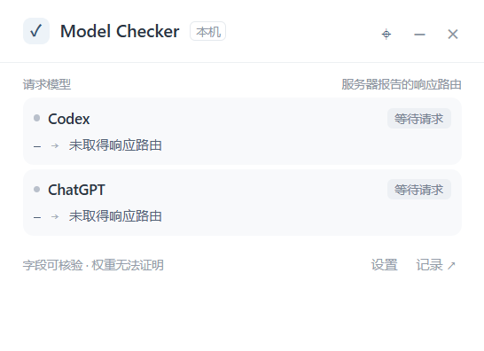

# Codex Model Checker

白色、简洁的 Windows 桌面 mini 窗口，汇总 **Codex + ChatGPT** 请求模型与服务器报告的响应路由，重点提示 **GPT-6 Astra 请求返回其他模型标识**。



这是模型字段的一致性检查工具。它不能证明服务器实际运行的模型权重，也不通过回答速度、写作风格或模型自述判断“降智”。本项目独立开发，不隶属于 OpenAI。

## 安装与使用

1. 在 [Releases](https://github.com/FrankWangTHU/codex-model-checker/releases) 下载 Windows x64 安装包与扩展 ZIP，可用 `SHA256SUMS.txt` 校验文件。
2. 运行安装包。程序默认启用 Windows 登录后在托盘后台启动；启动 Codex 或打开已连接的 ChatGPT 页面时显示小窗。可在托盘关闭自启动。
3. 解压扩展 ZIP，在 `edge://extensions` 或 `chrome://extensions` 开启开发者模式，选择“加载解压缩的扩展”，选中含 `manifest.json` 的目录。无需安装第三方同类扩展。
4. 在桌面小窗选择“设置 → 生成配对码”。点击浏览器扩展图标，输入 8 位配对码。配对码 5 分钟有效、只能使用一次；Chrome 和 Edge 分别配对。
5. 刷新已打开的 ChatGPT 页面，发送新消息。小窗将显示可取得的请求模型、响应路由和判断；点击记录可查看原始字段名及模型值。
6. Codex 会话日志会自动监听。若要尝试获取网络响应字段，在设置中启用“Codex 增强采集”，**重启 Codex**。代理没有捕获流量时，不能完成模型一致性核验。

关闭小窗会收回托盘；通过托盘“彻底退出”会先恢复 Codex 配置。恢复代理设置后，请重启 Codex。若后台程序退出或崩溃而 Codex 仍指向本地代理，重新打开本程序恢复服务，或使用安装目录中的 `Codex Model Checker.exe --restore-proxy` 恢复配置后重启 Codex。

## 如何理解结果

| 结果 | 含义 |
| --- | --- |
| 一致 | 对应网络请求和显式响应路由字段相同，或命中明确维护的别名映射 |
| 不一致 | 请求与显式响应路由不同；Astra 请求默认触发红色状态及一次静音系统通知 |
| 无法核验 | 缺少网络请求模型、缺少显式响应路由、只有模型标签/会话日志，或属于独立工具任务 |
| 证据冲突 | 同一请求中的响应路由字段或模型标签相互矛盾 |
| 自动路由 | 网络请求指定 `auto` 且取得显式响应路由 |

`assistant.metadata.model_slug` 是模型标签，独立展示，**不会仅凭标签判定一致**。显式响应字段包括 `response.model`、标准响应对象 `model`、`resolved_model_slug`、`server_ste_metadata.model_slug`。不同字段冲突时不会选择性忽略证据。未知模型后缀不会自动归入 Astra。

## Codex 支持边界

- 默认读取 `%USERPROFILE%\.codex\sessions` 下当日及前一日的 JSONL 会话记录，支持 `CODEX_HOME`。`turn_context.model` 只作为请求侧会话证据。
- 增强采集设置官方 OpenAI provider 的顶层 `openai_base_url`。保留模型参数，HTTP JSON/SSE 和 WebSocket 消息经过本机代理转发；不安装 HTTPS 根证书，不全局修改系统代理。
- 原来的 `openai_base_url` 被保留为上游，缺省为 `https://api.openai.com/v1`。自定义 provider 会拒绝自动改动。由配置 profile、账户登录路径或云端运行方式决定的请求，可能不经过这个地址。
- **不能保证 ChatGPT 登录模式的所有 Codex 桌面请求都受该设置影响。** 如果没有流量，保持“无法核验”；不要为了得到绿色状态切换认证模式、填写额外 API 密钥或主动发起付费测试请求。
- 修改前保存原配置备份；恢复时保留可识别的无关用户修改。代理项被外部改动时停止自动恢复并保留备份，避免覆盖用户设置。
- 代理只用于可配置转发的路径。当前没有实现 TLS 解密、证书绕过或对 Codex 程序的注入。

参见 [官方配置参考](https://learn.chatgpt.com/docs/config-file/config-reference)、[兼容性和测试说明](docs/COMPATIBILITY.md)。

## 隐私与本地数据

模型检测记录仅存在 `%APPDATA%\Codex Model Checker`，默认保留最近 30 天、最多 10,000 条。窗口列出最近 500 条，导出包含全部保留记录。可以清空全部检测记录。

不保存提示词、回答正文、Cookie、认证头或原始流量；不会将检测数据上传到第三方服务器。浏览器通过 `127.0.0.1:43821` 与桌面通信，使用单次配对码、令牌及扩展来源校验。代理监听 `127.0.0.1:43822`，使用随机路径令牌。

代理为转发必须在内存中处理原请求与认证头；解析器只提取白名单元数据。大于观察上限或压缩且无法解析的响应会停止提取证据，流量继续转发。配置备份可能包含原配置文件中的敏感设置，请勿将应用数据目录提交到仓库。详情见 [PRIVACY.md](PRIVACY.md)。

## 开发与打包

需要 Windows x64、Node.js 24 或更新版本。首次构建会下载 Electron 和 NSIS；下载失败时按自身网络环境设置 `HTTPS_PROXY`，不要关闭 TLS 或校验。

```powershell
npm ci
npm run typecheck
npm test
npm start
```

```powershell
npm exec -- playwright install chromium
npm run test:browser
$env:CMC_BROWSER_PATH = 'C:\Program Files (x86)\Microsoft\Edge\Application\msedge.exe'
npm run test:browser
Remove-Item Env:CMC_BROWSER_PATH
npm run test:ui
npm run package
```

产物：`release/Codex Model Checker Setup 0.1.0.exe`、`release/model-checker-extension-0.1.0.zip`、`release/SHA256SUMS.txt`。开发构建不会在首次启动自动注册登录项；打包版本默认注册。安装包未购买代码签名证书。

CI 在推送和 PR 时运行类型检查、核心集成测试、桌面与 Edge 离线端到端测试并生成安装包。首次成功的 `main` 构建自动创建 `v0.1.0` Release；已有版本不覆盖，后续发布使用新版本标签。

## 实现结构与参考

- `src/core`：共享模型比较、白名单提取、SSE 解析和记录类型。
- `src/main`：托盘窗口、本地桥接、配置代理、日志增量读取及记录存储。
- `src/extension`：页面原生 API 观察、隔离桥、扩展后台及配对页面。
- `tests`：模型判定、协议转发、取消、故障、并发、隐私、配置恢复、浏览器和桌面集成测试。

技术思路参考 [Liu-Bot24/chatgpt-route-inspector](https://github.com/Liu-Bot24/chatgpt-route-inspector)。本项目没有复制其源码、品牌或图片。项目代码使用 MIT 许可证，依赖遵循各自许可证。
